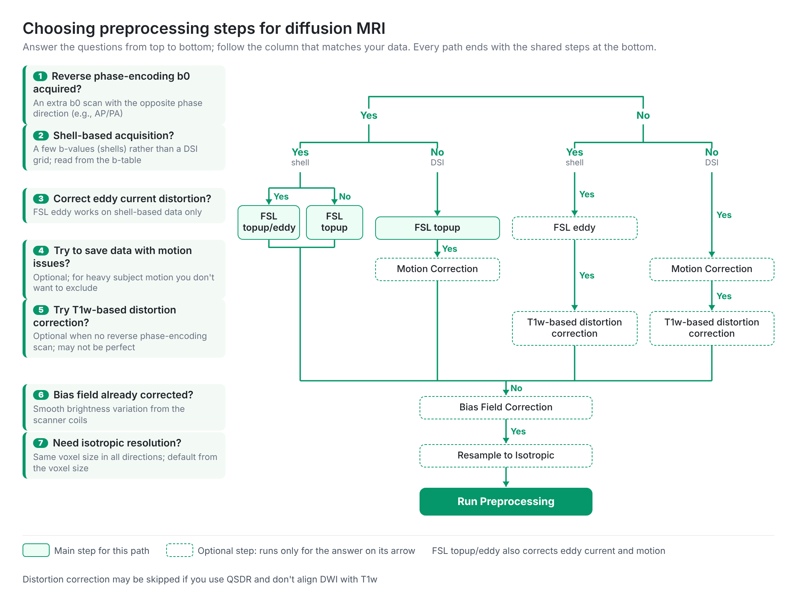

# Reconstruct: SRC to FIB

> **Before reconstruction:** Start with [Import: generate SRC files](/doc/gui_t1.html) to create an .sz file and review the diffusion images and b-table. Run [SRC quality control](/doc/gui_t1.html#step-t1a-quality-control) before reconstructing a study cohort. This page begins with an existing SRC file and produces a tractography-ready .fz file.

<iframe width="560" height="315" src="https://www.youtube.com/embed/-J8qBMiHQHk?start=215" title="SRC reconstruction tutorial" frameborder="0" allow="accelerometer; autoplay; clipboard-write; encrypted-media; gyroscope; picture-in-picture" allowfullscreen></iframe>

Reconstruction processes an SRC file (.sz; legacy .src.gz) and creates an FIB file (.fz) for [tractography](/doc/gui_t3_whole_brain.html), [diffusion measurements](/doc/how_to_interpret_dmri.html), [connectome analysis](/doc/gui_connectome.html), and other downstream workflows.

## Open SRC File(s)

In the current main window, choose Tractography›22 Reconstruct›SRC File(s) (*.sz) and select one or more SRC files. The ▸ More… section contains Batch SRC → FIB and SRC quality control.... The reconstruction window opens after selecting SRC data. Older videos may show the previous main-window layout.

Multiple SRC files can be reconstructed as a batch. Processing steps configured on the first file can be applied to the remaining selected files.

## Reconstruction dialog: page layout

The reconstruction dialog has a full-height left sidebar and three numbered
stages, followed by editing tools:

| Sidebar | Purpose |
|:--|:--|
| **2a Mask** | Create, refine, and inspect the reconstruction mask. |
| **2b Preprocessing** | Answer acquisition questions and run only applicable corrections. |
| **2c Methods** | Select DTI, GQI, or QSDR and choose outputs. |
| **▸ Edit...** | Expand to show **Edit DWI** and **Edit B-table**. |
| **Edit DWI** | Review diffusion volumes, correct image geometry, and edit signals. |
| **Edit B-table** | Inspect and adjust b-values and b-vectors. |

The **2a**, **2b**, and **2c** circles use three different green shades.
Expand **Edit...** to reveal the two editing pages. The output filename
control is below the right-hand pages for a single SRC file; it is hidden
for multi-file reconstruction. The left sidebar stays the full dialog height.

## Reconstruction window menus

The reconstruction window has five top-level menus. Their actions operate on the loaded SRC image and its reconstruction settings; inspect changes before saving or reconstructing.

| Top menu | What it does |
|:--|:--|
| File | **Open Mask...** and **Save Mask...**, plus SRC save and 4D NIfTI, b0, DWI-sum, and b-table exports. |
| Edit | Changes image orientation and geometry (flip/swap, AC–PC alignment, rotation, resampling), attaches other images, and offers signal/background or cropping operations. |
| B-table | Loads, saves, regenerates, checks, or flips/swaps diffusion-gradient directions. Incorrect changes alter estimated fiber orientations. |
| Corrections | Runs TOPUP/EDDY, T1w-guided distortion correction, motion/orientation correction, or bias-field correction as appropriate for the acquisition. |
| QSDR | Provides template-registration options, including manual alignment and partial-field-of-view controls for template-space reconstruction. |

These are the menus **inside the SRC reconstruction window**, not the main window's Tractography›22 Reconstruct entries.

## Visual quality inspection

Before reconstruction, inspect the raw DWI/source-image view and b-table for obvious problems.

### Motion and distortion

Use the b-table/image list to move through the diffusion volumes and look for motion, distortion, signal dropout, or inconsistent slices.

### Bad slices

Use Show bad slice to highlight detected problematic slices. Sagittal and coronal views can make slice artifacts easier to identify.

For additional examples, see the [quality-control video](https://www.youtube.com/watch?v=stL4GMeTC1I).

## Specify a mask

The reconstruction mask limits processing to the tissue of interest. The mask editor provides thresholding and common morphological operations including smoothing, expansion, erosion, and defragmentation.

A typical starting sequence is Thresholding → Smoothing → Defragment, followed by visual inspection and manual correction if needed.

Use **File → Open Mask...** to load a mask, or **File → Save Mask...** to export one. These actions have moved from buttons on the Mask page to the File menu. Use a mask with the same image dimensions as the source.

## Corrections and preprocessing

Only apply corrections that are appropriate for the acquisition and study design. Keep the processing consistent across subjects in a group analysis. For the reasoning behind each correction, see [How to preprocess dMRI](/doc/how_to_preprocess_dmri.html).

### Preprocessing page
{: #preprocessing }

Choose **2b Preprocessing** in the sidebar. The current page is a
question-driven flow: the first two answers choose one of four branches
(reverse-phase data present or absent × shell-based or DSI sampling).
Optional corrections and the shared final steps depend on the other
answers and on what has already been recorded in the SRC methods report.

#### The seven questions

| Question shown in the dialog | What to choose |
|:--|:--|
| **1. Reverse phase-encoding b0?** | **Yes** when a matching reverse-phase b0 image is available; selecting it prompts for an image file. Otherwise choose **No**. |
| **2. Shell-based acquisition?** | **Yes** for shell-based DWI; **No** for DSI-grid acquisitions. DSI Studio proposes an answer based on the b-table and displays its detected classification near the top of the page. |
| **3. Try to save data with motion issues?** | Optional on the applicable no-EDDY routes. Consider it for important motion artifacts; avoid redundant motion correction after EDDY. |
| **4. Try T1w-based distortion correction?** | An optional alternative on eligible paths without a reverse-phase scan. **Yes** prompts for the subject's T1w file. The result may not be perfect. |
| **5. Bias field already corrected?** | **Yes** means skip bias-field correction. **No** selects it if the methods report does not already indicate it was applied. |
| **6. Need isotropic resolution?** | **Yes** when resampling is appropriate for anisotropic voxels; the dialog proposes the initial answer based on voxel size. |
| **7. Correct eddy current distortion?** | Available for shell-based data. When reverse-phase data are present, **Yes** selects combined TOPUP/EDDY and **No** selects TOPUP alone. |

The defaults reflect source information: the shell-based question is
preselected using the b-table and the isotropic-resolution question using
voxel size; the other questions initially default to **No**. Inspect the
acquisition and existing preprocessing before accepting those suggestions.

#### Running the highlighted steps

1. If choosing **Yes** for reverse-phase images or T1w correction,
   select the appropriate file. Canceling the file picker returns that
   answer to **No**.
2. Read the highlighted path. Green indicates the selected branch;
   dashed steps are conditional. Steps recognized in the SRC methods
   report show **✓**. Ineligible questions are disabled.
3. Choose **Run Preprocessing** to execute the active steps in order.
   DSI Studio skips steps recognized as complete and stops if a
   command fails or is canceled. Individual step buttons also remain
   available.

Depending on the branch, the flow can use TOPUP, TOPUP/EDDY, EDDY alone,
motion correction, or T1w-based correction, followed by applicable
bias-field correction and isotropic resampling. **Not every operation
belongs in every pipeline.** The completion markers come from recorded
processing text: verify the processing history and output rather than
relying on the checkmark alone. Save the corrected SRC as a **new** file
to preserve the unmodified input.

### TOPUP/EDDY and motion correction

For reverse-phase-encoding acquisitions, use Corrections›TOPUP/EDDY.... DSI Studio first looks for the matching .rz companion file. If one is not found, it can accept another reverse-phase-encoding .sz, .rz, legacy .src.gz, or NIfTI file.

For acquisitions without a reverse-phase pair, use the applicable EDDY/motion-correction workflow.

### T1w distortion correction

When there is no reverse-phase pair but a T1w image of the same subject is available, use Corrections›T1w Distortion Correction... to correct susceptibility distortion. Select the T1w file, then choose the output resolution (**Native**, **1.5 mm isotropic**, or **1.0 mm isotropic**).

DSI Studio converts the first b0 image to a T1-like contrast and extracts the brain from the T1w using U-Net, followed by bias field correction. It then registers the T1w rigidly to the b0 and estimates a nonlinear deformation restricted to the anterior–posterior (y) axis. Every DWI volume is warped once from the original data using T1w-guided interpolation and Jacobian signal modulation, and the mask is regenerated from the corrected images. The correction is recorded in the methods report.

The correction assumes AP–PA phase encoding. Run EDDY or motion correction before it, because the same deformation is applied to all volumes. The selected output resolution replaces a separate resampling step.

These corrections may take substantial processing time. Save the corrected source data as a new .sz file if you want to preserve the corrected dataset for later reconstruction.

### Volume orientation correction for animal scans

Animal datasets may need orientation adjustment before template-based analysis. Use Corrections›Volume Orientation Correction... to align the volume orientation with the selected template.

When the slice-position slider moves toward the superior end of the volume, the displayed anatomy should follow the orientation expected by the selected template. Use image flip/swap operations only when necessary, and verify the result visually after each change.

### Remove background or crop the image volume

Use Edit › Erase Background Signals or Crop Background Volume to remove irrelevant signal or excessive empty space when appropriate.

### Check b-table orientation

An incorrect b-table produces incorrect fiber orientations. Use B-table›Check B-table... and inspect the result anatomically. Low-SNR or unusual animal acquisitions may require manual verification.

## Edit DWI and Edit B-table

Expand **▸ Edit...** in the sidebar. **Edit DWI** shows the volume list
and image viewer, with image/signal editing sections that can be opened
below it. **Align Selected DWI...** rigidly aligns the currently selected
**3D DWI volume** to the first diffusion volume and adjusts its
b-vector. It is *not* a slice-by-slice alignment tool. Use it only when
that individual-volume registration is intended; inspect the result.

**Edit B-table** is for checking and correcting diffusion gradient
directions. Changing orientation or b-vectors affects reconstructed
fiber directions.

## Choose a reconstruction method

### Diffusion Tensor Imaging (DTI)

DTI estimates a diffusion tensor and tensor-derived measures such as FA, MD, AD, and RD. It provides one principal tensor direction per voxel and is appropriate when tensor measurements are the intended analysis.

### Generalized Q-Sampling Imaging (GQI)

GQI is the standard DSI Studio reconstruction for resolving one or more fiber orientations and is commonly used for native-space tractography.

The **diffusion sampling length ratio** controls GQI sampling. The appropriate value depends on acquisition and tissue properties. When changing it, verify the resulting fiber orientations and whole-brain tractography rather than selecting a value from the appearance of a single pathway.

### Q-Space Diffeomorphic Reconstruction (QSDR)

QSDR reconstructs diffusion information in a selected template space and is commonly used for population, atlas, and connectometry analyses.

Select the template appropriate for the species and study. Inspect registration quality before including a subject in population analysis.

When needed by reconstruction or template registration, attach auxiliary images through Edit › Attach Images....

The **2c Methods** page presents the common settings first. Click
**▸ More...** to expose additional method settings and output
options. Method-specific controls appear only when relevant to the
selected reconstruction method.

## Choose outputs

Select only the additional diffusion measurements needed for the analysis. Available outputs depend on the reconstruction method and DSI Studio version and can include tensor measures, GQI-derived measures, restricted-diffusion measures, and ODF-related outputs.

Metric checkboxes are arranged in up to **three columns per row** in the current dialog. Some advanced metrics appear only after expanding **More...**. Saving unnecessary outputs increases .fz file size and processing time.

### DTI high-b option

**ignore high b** restricts tensor estimation to lower b-values when appropriate for the acquisition. Use the same rule across subjects in a group study.

## Batch reconstruction

Use Tractography›22 Reconstruct›▸ More…›Batch SRC → FIB to process multiple .sz files. SRC quality control... is in the same expanded section. Batch execution applies the configured reconstruction to a group of subjects, but it does not replace inspecting representative images and evaluating [SRC quality control](/doc/gui_t1.html#step-t1a-quality-control) first.

The resulting reconstructed files use .fz. For population studies, use **QSDR with the same template and output resolution** across subjects before preparing a [correlational tractography database](/doc/gui_cx.html#create-a-connectometry-database). For longitudinal or cross-sectional differential analysis, see [Differential Tractography](/doc/gui_t3_dt.html).

## Reconstruct

After checking the mask, corrections, reconstruction method, template settings, and requested outputs, click Run Reconstruction. The resulting .fz file can be opened via Tractography›33 Track›FIB File (*.fz) or used by the corresponding command-line and population-analysis workflows.

For command-line reconstruction, see [Reconstruction CLI](/doc/cli_t2.html).
