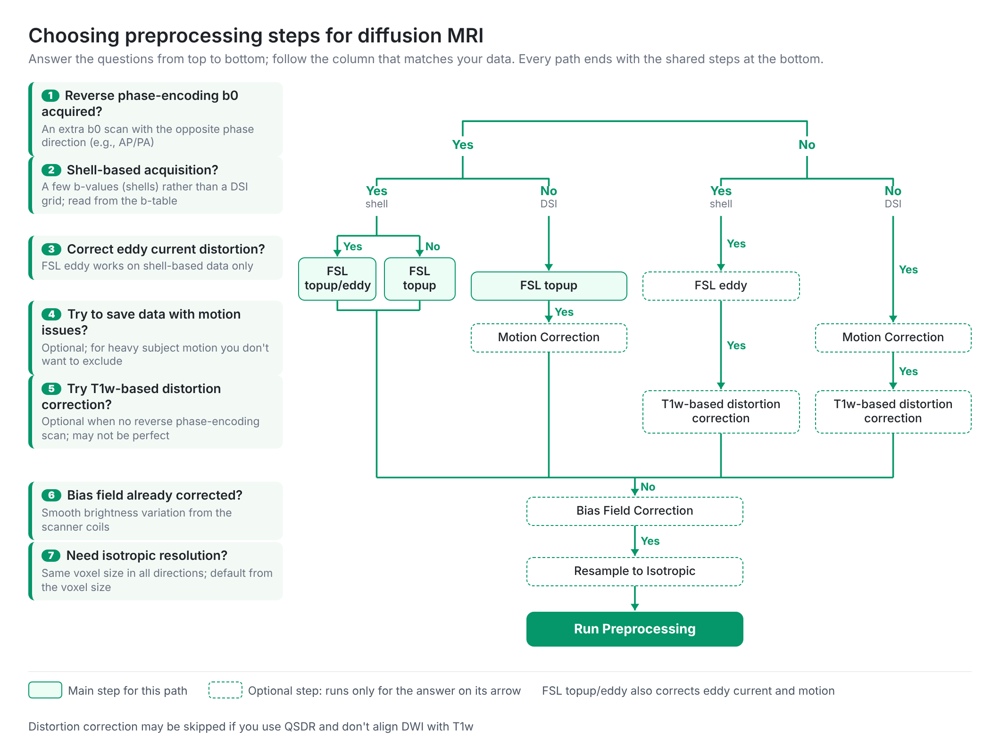

# How to Preprocess dMRI

Preprocessing corrects artifacts in diffusion MRI before reconstruction. Not every dataset needs every correction: the right choice depends on how the data were acquired and on how the results will be used.

## Principle: less processing, less information loss
{: #principle }

Every processing step modifies the diffusion signals, and the more steps are added, the more information is lost. Preprocessing can be part of a routine pipeline, but each step should be checked for whether it is necessary. Most DWI studies apply susceptibility and eddy current correction, for example FSL topup and eddy, yet neither is absolutely needed if the sequence already handles these artifacts well. Corrections that turn unusable data into usable data are the ones most worth keeping.

## Decision flow
{: #decision-flow }

Answer the questions from top to bottom. The first two questions choose a column; the steps in that column, followed by the shared steps at the bottom, form the preprocessing. Dashed steps are optional and apply only when the question in the same row is answered as shown on its arrow.

## Susceptibility distortion
{: #susceptibility }

Echo-planar imaging is sensitive to magnetic susceptibility differences at air–tissue boundaries. The artifacts are strongest at the frontal tip, near the sinuses, and at the temporal base, where signals can be compressed, stretched, or lost. Susceptibility also distorts the entire head along the phase-encoding direction, typically by a few voxels.

<strong>When is it needed?</strong>
Susceptibility distortion can cause a large mismatch between DWI and structural images, which affects targets aligned from the subject's structural images, for example T1w-based regions or surgical planning. In a group study where all data are spatially normalized to a template, it matters much less.

* **With a reverse phase-encoding b0:** the two opposite-phase images allow the distortion field to be estimated, for example with FSL topup. For shell-based data that also need eddy correction, both can be corrected together (FSL topup/eddy).
* **Without a reverse phase-encoding scan:** the b0 image can be warped to the subject's T1w image. This is optional, and the correction may not be perfect.

## Eddy current distortion
{: #eddy }

Eddy currents from the diffusion gradients shift, shear, or scale the diffusion-weighted images, differently for each gradient direction. Correct them only if the distortion is obvious, for example when edges in different DWI volumes do not line up. Many newer sequences reduce eddy currents considerably, for instance with bipolar diffusion encoding, so check whether it is needed for your sequence.

FSL eddy requires shell-based acquisitions; grid (DSI) sampling relies on eddy-current compensation at acquisition instead (see [How to acquire dMRI](/doc/how_to_acquire_dmri.html)).

## Motion
{: #motion }

Eddy correction also corrects motion. Alternatively, motion and eddy distortion can be detected from the correlation between neighboring DWI volumes, and the few outlier volumes can be dropped. Instead of correcting motion-corrupted data, dropping outliers is often a simpler solution. If the subject moved a lot and the reconstruction is corrupted, correction may rescue the data, but acquiring new data is often the best solution.

## Bias field
{: #bias-field }

The bias field is a smooth brightness variation across the image caused by the receiver coils. Correcting it evens out the signal and is recommended unless the data were already corrected.

## Isotropic resolution
{: #isotropic }

This is perhaps the most important step: tractography needs an isotropic voxel size and fails when the resolution differs greatly between directions. If the voxels are not isotropic, resample the data to an isotropic resolution.

## Denoising
{: #denoising }

Denoising is generally not recommended. It smooths the signals, which blurs spatial information and can spread local structures into their neighbors. The exception is very noisy data: if denoising lowers the noise enough to retain usable DWI signals, it can turn unusable data into usable data.

## In DSI Studio

The reconstruction window follows this decision flow on its Preprocessing page. See [Reconstruct: preprocessing](/doc/gui_t2.html#preprocessing) for step-by-step usage.
