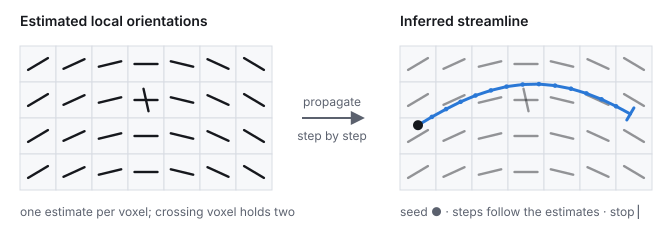
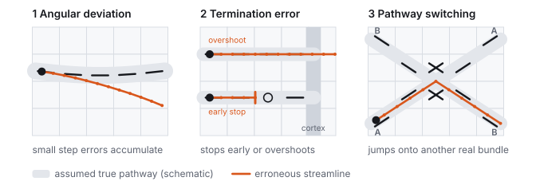
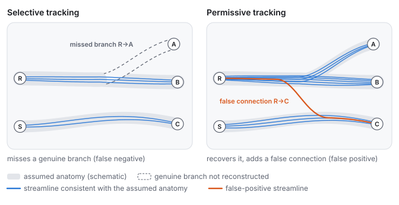

# Practical Tips for Tractography: Common Pitfalls and What to Watch For

Diffusion MRI tractography is a powerful noninvasive way to study white-matter pathways in the living human brain, but it is also easy to over-interpret. The suggestions below summarize how I usually think about tractography when choosing a method, checking a result, or deciding how much confidence to place in a pathway.

The most useful starting point is simple:

Diffusion MRI estimates local directional information. Tractography uses that local information to infer long-range pathways.

A streamline is therefore an **inference produced by an algorithm**. It is not an individual axon, and a dense bundle of streamlines is not direct proof of a dense anatomical connection.

<figure class="tt-fig"><picture><source media="(max-width: 760px)" srcset="/images/tutorial_tractography_pipeline_mobile.svg"></picture><figcaption>Diffusion MRI yields an <em>estimated</em> orientation in each voxel. Tractography propagates a streamline through those estimates; the result is an inference, not an observed axon.</figcaption></figure>

## Myth 1: Higher angular resolution automatically gives better tractography

Higher angular resolution can help resolve crossing fibers. DTI usually resolves one dominant orientation in a voxel, whereas GQI-derived diffusion ODFs and fiber orientation distributions (FODs) can represent multiple orientations. This additional resolving power can recover pathways that tensor-based tracking may miss.

But **resolving more directions is not the same as mapping more true connections**.

<figure class="tt-fig tt-pub"><figcaption>Figure 3 from <a href="https://doi.org/10.1016/j.neuroimage.2021.118651">Yeh et al., <em>NeuroImage</em> 2021</a>. The same diffusion data are reconstructed using the tensor model, GQI diffusion ODFs, and FODs.</figcaption></figure>

This comparison is useful because it shows both the benefit and the limitation of increasing angular resolving power. DTI may miss crossing branches such as lateral callosal fibers. GQI can recover additional fiber populations. FOD can provide still higher resolving power, yet the extra angular detail does not automatically translate into better anatomical accuracy. In superficial white matter, the FOD result can also produce orientations perpendicular to the gyrus and arc-shaped spurious tracks that are not supported by the corresponding histology.

The important distinction is therefore:

<blockquote class="tt-key">
<strong>Better local fiber resolving does not automatically mean better global anatomical mapping.</strong>
</blockquote>

A sharper orientation distribution, a higher spherical-harmonic order, or a model capable of producing more peaks should not by itself be treated as evidence of better tractography.

<strong>Practical suggestion:</strong> use enough angular resolution to resolve the anatomy required by the scientific question, then judge the result against anatomy and the complete pathway rather than the number or sharpness of local peaks.

## Myth 2: Crossing fibers are the main tractography problem

Crossing fibers are important, but they are only one of several anatomical challenges. Different parts of the brain create very different tracking problems.

<figure class="tt-fig tt-pub"><figcaption>Figure 1 from <a href="https://doi.org/10.1016/j.neuroimage.2021.118651">Yeh et al., <em>NeuroImage</em> 2021</a>. Histology illustrates three distinct anatomical settings that challenge tractography.</figcaption></figure>

The figure highlights three particularly useful examples:

- **Superficial white matter and gyral blades:** fibers fan toward the cortex and can turn sharply near the gray-white matter boundary. Tracking algorithms tend to favor less sharply turning trajectories, producing gyral bias and missed sulcal terminations.
- **Deep white matter:** association, projection, and commissural pathways intersect, branch, and fan in the centrum semiovale. This is the classic crossing-fiber problem, but it is only one region of difficulty.
- **Subcortical nuclei:** small pathways intermingle with large projection bundles, while limited spatial resolution and low diffusion signal can make local orientations difficult or impossible to resolve reliably.

The lesson I would keep in mind is:

<blockquote class="tt-key">
<strong>Tractography is an anatomical inference problem, not simply an angular-resolution problem.</strong>
</blockquote>

Improving crossing-fiber resolution helps one part of the problem, but it does not solve gyral bias, incorrect termination, limited spatial resolution, poor signal, or ambiguous long-range routing.

<strong>Practical suggestion:</strong> before changing reconstruction or tracking parameters, first identify <em>where</em> the pathway is difficult anatomically. The appropriate solution depends on whether the main limitation is crossing, turning, termination, spatial resolution, signal quality, or pathway ambiguity.

## Myth 3: If the local fiber directions are correct, the pathway will be correct

Even good local orientation estimates do not guarantee a correct long-range trajectory.

<figure class="tt-fig"><picture><source media="(max-width: 760px)" srcset="/images/tutorial_tractography_error_modes_mobile.svg"></picture><figcaption>Schematic. Grey bands are an <em>assumed</em> true pathway drawn for illustration; in a typical in-vivo scan the true pathway is not observed.</figcaption></figure>

Three common mechanisms are:

1. **Angular deviation.** Small directional errors accumulate as a streamline propagates.
2. **Termination error.** A streamline may stop too early or continue beyond the true end of a pathway.
3. **Pathway switching.** At a crossing or branching region, a tracking algorithm can move from one real fiber population onto another real fiber population and create a connection that does not exist anatomically.

The third case is especially important: every local orientation along a false streamline can look plausible while the **complete connection is wrong**.

<strong>Practical suggestion:</strong> evaluate the full pathway and its anatomical endpoints, not just the local orientation field.

## Myth 4: More streamlines mean better mapping

Generating more streamlines usually increases sensitivity. It can also increase false positives.

<figure class="tt-fig"><picture><source media="(max-width: 760px)" srcset="/images/tutorial_tractography_streamlines_mobile.svg"></picture><figcaption>Schematic over the same assumed anatomy. Streamline density is illustrative only; it is not a count of axons or connections.</figcaption></figure>

A tractogram with millions of streamlines may look impressive, but streamline count is affected by seeding strategy, stopping criteria, angular threshold, anisotropy threshold, tracking algorithm, reconstruction method, and post-processing.

Therefore:

<blockquote class="tt-key">
<strong>Streamline count is an algorithm output, not an axon count.</strong>
</blockquote>

A useful tractography result balances sensitivity with anatomical specificity. For many scientific questions, a smaller set of reproducible and anatomically plausible pathways is more informative than a visually dense whole-brain tractogram.

## False positives and false negatives: a sensitivity–specificity tradeoff

DSI Studio's commonly used GQI-based deterministic tractography follows locally supported directions to produce reproducible streamlines. With selective tracking criteria and anatomical constraints, it can favor **fewer false-positive connections (higher specificity)**, but this may come at the expense of **missing genuine branches or connections (higher false-negative rate)**, especially in complex crossing, fanning, sharply turning, or low-anisotropy regions. An absent streamline should therefore not be interpreted as proof that the anatomical pathway is absent.

Methods emphasizing high crossing-fiber sensitivity, including some FOD-based and probabilistic tracking pipelines, can recover pathways missed by more selective tracking (**fewer false negatives**). However, accepting more candidate trajectories may also introduce anatomically unsupported connections (**more false positives**). Probabilistic streamline frequency is not itself the probability that a connection exists.

This is a **general tradeoff, not a fixed accuracy ranking of DSI Studio versus other software**. Diffusion model, seeding, thresholds, anatomical constraints, tract selection, and the pathway being tested all affect sensitivity and specificity. Tracer-based comparisons show that increasing sensitivity often decreases specificity (Thomas et al., 2014), and simulated connectome benchmarks show that recovering many true bundles can coexist with numerous invalid bundles (Maier-Hein et al., 2017). Connectome studies likewise report sparse, potentially incomplete deterministic results versus denser probabilistic results that require careful thresholding (Zalesky et al., 2016; Sarwar et al., 2019).

<strong>Practical interpretation:</strong> A tract present in a reconstruction may still be a false positive; a tract absent from a reconstruction may still be a false negative. Prefer anatomically constrained, reproducible reconstructions and interpret negative findings particularly cautiously when testing pathways that are difficult to track.

## Practical checks I find useful

Good tractography rarely comes from one "best" reconstruction or tracking algorithm. It usually comes from several sources of information agreeing with one another.

1<strong>Start with anatomy</strong>What pathway, cortical territory, or network am I trying to study? What course and endpoints are anatomically plausible?

2<strong>Check acquisition and preprocessing</strong>Is the spatial resolution, angular sampling, SNR, distortion correction, and motion correction adequate for the target anatomy?

3<strong>Resolve only supported angular detail</strong>Does the reconstruction recover necessary crossing fibers without introducing unstable peaks?

4<strong>Use appropriate tracking constraints</strong>Are turning angle, step size, anisotropy/termination threshold, and seeding strategy appropriate for the pathway?

5<strong>Use anatomical information</strong>Can ROI, ROA, endpoint, terminating, or other anatomical constraints reduce implausible routes?

6<strong>Inspect the complete pathway</strong>Does the tract follow plausible anatomy and terminate where expected? Are there obvious false continuations or missing branches?

7<strong>Test robustness</strong>Does the finding persist across reasonable parameter changes, repeated scans, subjects, templates, or atlases?

8<strong>Interpret conservatively</strong>Is the conclusion supported by the measurement? Avoid equating streamlines with axons or streamline counts with connection strength without validation.

## A useful way to think about tractography

Instead of asking
Which tractography method is the most advanced?

I find it more useful to ask
Which combination of data, reconstruction, tracking, anatomical constraints, and validation best answers this particular anatomical or scientific question?

This also explains why higher angular resolution does not automatically win. Better local directional information is valuable, but tractography accuracy depends on the entire chain:

<ol class="tt-chain" aria-label="Tractography chain"><li>diffusion acquisition</li><li>preprocessing</li><li>local orientation estimation</li><li>tracking</li><li>termination</li><li>anatomical selection</li><li>validation</li><li>interpretation</li></ol>

An improvement at one step cannot automatically correct errors introduced at another.

## References

1. Yeh FC, Irimia A, Bastos DCA, Golby AJ. Tractography methods and findings in brain tumors and traumatic brain injury. *NeuroImage*. 2021;245:118651. <https://doi.org/10.1016/j.neuroimage.2021.118651>
2. Maier-Hein KH, Neher PF, Houde JC, et al. The challenge of mapping the human connectome based on diffusion tractography. *Nature Communications*. 2017;8:1349. <https://doi.org/10.1038/s41467-017-01285-x>
3. Reveley C, Seth AK, Pierpaoli C, et al. Superficial white matter fiber systems impede detection of long-range cortical connections in diffusion MR tractography. *PNAS*. 2015;112:E2820-E2828. <https://doi.org/10.1073/pnas.1418198112>
4. Thomas C, Ye FQ, Irfanoglu MO, et al. Anatomical accuracy of brain connections derived from diffusion MRI tractography is inherently limited. *PNAS*. 2014;111:16574–16579. <https://doi.org/10.1073/pnas.1405672111>
5. Zalesky A, Fornito A, Cocchi L, et al. Connectome sensitivity or specificity: which is more important? *NeuroImage*. 2016;142:407–420. <https://doi.org/10.1016/j.neuroimage.2016.06.035>
6. Sarwar T, Ramamohanarao K, Zalesky A. Mapping connectomes with diffusion MRI: deterministic or probabilistic tractography? *Magnetic Resonance in Medicine*. 2019;81:1368–1384. <https://doi.org/10.1002/mrm.27471>
