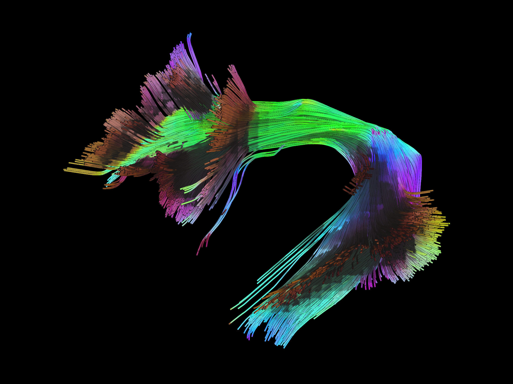
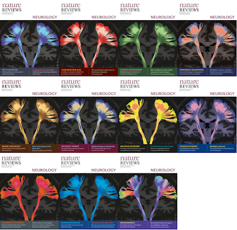
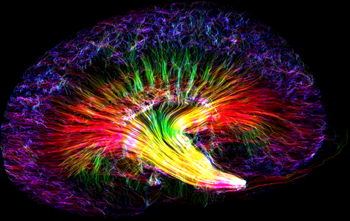
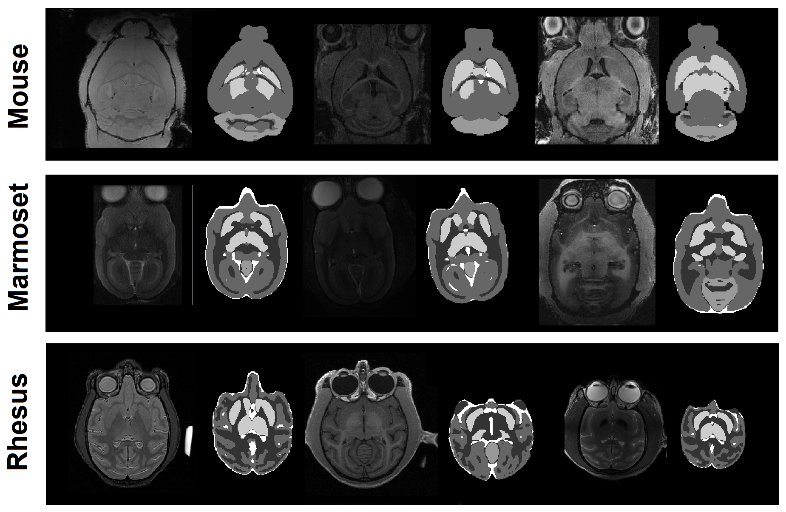

<section class="hero">
  

    <a class="paper" href="https://doi.org/10.1038/s41592-025-02762-8"><b>Nature Methods 2025</b>Platform paper →</a>
    <h1>Tractography, connectomics and fiber data, in one open platform.</h1>
    
Reconstruct diffusion MRI, map white-matter pathways, run group analysis and segment brain MRI on Windows, macOS, Linux or Docker. No installation needed.

    

      <a class="btn primary" href="/download.html">Download</a>
      <a class="btn" href="/doc/how_to_analyze_dmri.html">Start the tutorial</a>
      <a class="btn" href="https://brain.labsolver.org">Browse the Fiber Data Hub</a>
    

    
Sun {{ site.sun_version }} · Windows · macOS · Linux · Docker · <a href="https://github.com/frankyeh/DSI-Studio" style="color:inherit">source on GitHub</a>

  

  <figure class="shot" style="margin:0"><figcaption>Left arcuate fasciculus (HCP-1065 atlas), DSI Studio</figcaption></figure>
</section>

<section class="stats two">
  
<b>3,000+</b>publications using DSI Studio

  
<b>30,000+</b>processed datasets on the Hub

</section>

<section class="doors">
  

    <h3>Learn</h3>
    
Concepts first, then the exact clicks.

    <ul>
      <li><a href="/doc/how_to_acquire_dmri.html">How to acquire dMRI</a></li>
      <li><a href="/doc/how_to_analyze_dmri.html">How to analyze dMRI</a></li>
      <li><a href="/doc/how_tractography_works.html">How to interpret tractography</a></li>
      <li><a href="/doc/gui_t1.html">GUI manual · Command line →</a></li>
    </ul>
  

  

    <h3>Data</h3>
    
Start from processed .fz / .sz / .dz files instead of raw DWI.

    <ul>
      <li><a href="https://brain.labsolver.org">HCP · ABCD · OpenNeuro</a></li>
      <li><a href="https://brain.labsolver.org">INDI · TCIA · others</a></li>
      <li><a href="/doc/cli_data.html">Data formats</a></li>
      <li><a href="https://brain.labsolver.org">Open the Fiber Data Hub →</a></li>
    </ul>
  

  

    <h3>Support</h3>
    
Questions answered by the developer and community.

    <ul>
      <li><a href="https://groups.google.com/g/dsi-studio">Forum (Google)</a></li>
      <li><a href="https://www.reddit.com/r/dsistudio/">Forum (Reddit)</a></li>
      <li><a href="https://www.dropbox.com/request/W0hJkAIVC2keWAjqtqvU">Upload data for help</a></li>
      <li><a href="/news.html">News &amp; bug notices →</a></li>
    </ul>
  

</section>

<section class="section">
  

    <h2>AI agents, in the Sun version</h2>
    
Connect a supported local agent and ask in plain language: it reads the manuals, inspects the current data and runs reconstruction, tracking, image processing or connectometry.

    
CodexClaude CodeMuseAntigravityGrok

  

  

    
youTrack the left arcuate fasciculus in this FIB file and export FA along the tract.

    
agentOpened subject01.fz · AutoTrack AF_L · FA along tract saved (illustrative)

    
rundsi_studio --action=atk --source=subject01.fz --track_id=AF_L

  

</section>

<section class="research" id="research">
  

  

    <h2>Research</h2>
    
DSI Studio has been cited in Nature Neuroscience, Nature Human Behaviour, Brain and NeuroImage, and its tractography appeared on the cover of Nature Reviews Neurology (2017). It is used across diffusion MRI datasets and imaging protocols to reconstruct white-matter pathways, map connectivity and compare tractography results.

    
DTI · GQI · QSDRAutoTrackDifferentialCorrelationalU-Net segmentation

    

      <small>Nature Methods · July 2025</small>
      Yeh, F.-C. DSI Studio: An integrated tractography platform and Fiber Data Hub for accelerating brain research.
      <a href="https://doi.org/10.1038/s41592-025-02762-8">doi:10.1038/s41592-025-02762-8</a> · <a href="/citation.html">How to cite</a>
    

  

</section>

<section class="hub">
  

    <h2>Fiber Data Hub</h2>
    
Compact processed diffusion MRI derivatives (<b style="color:#16181d">.fz</b>, <b style="color:#16181d">.sz</b>, <b style="color:#16181d">.dz</b>) that open directly in DSI Studio, without repeating preprocessing from raw DWI. More than 30,000 fiber datasets as of the Nature Methods 2025 paper, from HCP, ABCD, OpenNeuro, INDI, TCIA and other public datasets.

  

  <ul>
    <li><a href="https://brain.labsolver.org/#repository-list">Browse repositories →</a></li>
    <li><a href="https://brain.labsolver.org/qc.html">Search by quality control →</a></li>
    <li><a href="https://brain.labsolver.org/download.html">Download guide →</a></li>
  </ul>
</section>

<section class="gallery">
  <figure>
    

    <figcaption>
      <h3>Ex-vivo and histology</h3>
      
High-resolution ex-vivo diffusion MRI and MRI microscopy, for structural analysis of biological tissue.

      <small>Kidney Rainbow by Nian Wang, Center for In Vivo Microscopy, Duke University. Coverage by <a href="https://doi.org/10.1126/science.363.6427.564">Science</a>.</small>
    </figcaption>
  </figure>
  <figure>
    

    <figcaption>
      <h3>Brain MRI segmentation</h3>
      
U-Net based segmentation for structural MRI runs inside DSI Studio, with no Python or deep-learning environment to install.

      <small>Segmentation examples from <a href="https://unet-studio.labsolver.org">U-Net Studio</a>, the sister project.</small>
    </figcaption>
  </figure>
</section>

<section class="start">
  

    <h2>Get started</h2>
    
No installation needed: download, unzip and run.

    

      
      
      
    

  

  

    <a href="/download.html">Download<small>Sun {{ site.sun_version }}</small></a>
    <a href="/news.html">News<small>features · fixes</small></a>
    <a href="https://groups.google.com/g/dsi-studio">Forum<small>questions</small></a>
    <a href="https://brain.labsolver.org">Data Hub<small>datasets</small></a>
  

</section>
