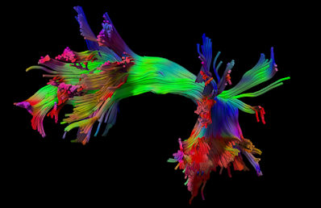

<section class="hero">
  

    <a class="paper" href="https://doi.org/10.1038/s41592-025-02762-8"><b>Nature Methods 2025</b>Platform paper →</a>
    <h1>Tractography, connectomics and fiber data, in one open platform.</h1>
    
Reconstruct diffusion MRI, map white-matter pathways, run group analysis and segment brain MRI on Windows, macOS, Linux or Docker. No installation needed.

    

      <a class="btn primary" href="/download.html">Download</a>
      <a class="btn" href="/doc/how_to_analyze_dmri.html">Start the tutorial</a>
      <a class="btn" href="https://brain.labsolver.org">Browse the Fiber Data Hub</a>
    

    
Sun {{ site.sun_version }} · Windows · macOS · Linux · Docker · <a href="https://github.com/frankyeh/DSI-Studio" style="color:inherit">source on GitHub</a>

  

  <figure class="shot" style="margin:0"><figcaption>Left arcuate fasciculus, DSI Studio</figcaption></figure>
</section>

<section class="stats">
  
<b>3,000+</b>publications using DSI Studio

  
<b>50,000+</b>processed datasets on the Hub

  
<b>29</b>documentation guides

  
<b>4</b>platforms: Windows, macOS, Linux, Docker

</section>

<section class="doors">
  

    <h3>Learn</h3>
    
Concepts first, then the exact clicks.

    <ul>
      <li><a href="/doc/how_to_acquire_dmri.html">How to acquire dMRI</a></li>
      <li><a href="/doc/how_to_analyze_dmri.html">How to analyze dMRI</a></li>
      <li><a href="/doc/how_tractography_works.html">How to interpret tractography</a></li>
      <li><a href="/doc/gui_t1.html">GUI manual · Command line →</a></li>
    </ul>
  

  

    <h3>Data</h3>
    
Start from processed .fz / .sz / .dz files instead of raw DWI.

    <ul>
      <li><a href="https://brain.labsolver.org">HCP · ABCD · OpenNeuro</a></li>
      <li><a href="https://brain.labsolver.org">INDI · TCIA · others</a></li>
      <li><a href="/doc/cli_data.html">Data formats</a></li>
      <li><a href="https://brain.labsolver.org">Open the Fiber Data Hub →</a></li>
    </ul>
  

  

    <h3>Support</h3>
    
Questions answered by the developer and community.

    <ul>
      <li><a href="https://groups.google.com/g/dsi-studio">Forum (Google)</a></li>
      <li><a href="https://www.reddit.com/r/dsistudio/">Forum (Reddit)</a></li>
      <li><a href="https://www.dropbox.com/request/W0hJkAIVC2keWAjqtqvU">Upload data for help</a></li>
      <li><a href="/news.html">News &amp; bug notices →</a></li>
    </ul>
  

</section>

<section class="section">
  

    <h2>AI agents, in the Sun version</h2>
    
Connect a supported local agent and ask in plain language: it reads the manuals, inspects the current data and runs reconstruction, tracking, image processing or connectometry.

    
CodexClaude CodeMuseAntigravityGrok

  

  

    
youTrack the left arcuate fasciculus in this FIB file and export FA along the tract.

    
agentOpened subject01.fz · AutoTrack AF_L · FA along tract saved (illustrative)

    
rundsi_studio --action=atk --source=subject01.fz --track_id=AF_L

  

</section>

<section class="section">
  

  

    <h2>Research applications</h2>
    
Cited in Nature Neuroscience, Nature Human Behaviour, Brain and NeuroImage; on the cover of Nature Reviews Neurology (2017); used in diffusion MRI, tractography and structural connectomics research.

    
DTI · GQI · QSDRAutoTrackDifferentialCorrelationalU-Net segmentation

  

</section>

<section class="section">
  

    <h2>Fiber Data Hub</h2>
    
The <strong>Fiber Data Hub</strong> extends DSI Studio from a software tool to a software-and-data platform. It provides direct access to compact processed diffusion MRI derivatives that can be downloaded and analyzed without repeating the full preprocessing pipeline from raw DWI.

    
The Hub currently hosts <strong>more than 50,000 processed fiber datasets</strong> from major neuroimaging resources including <strong>HCP</strong>, <strong>ABCD</strong>, <strong>OpenNeuro</strong>, <strong>INDI</strong>, <strong>TCIA</strong>, and other public datasets. DSI Studio uses compact formats such as <strong>.fz</strong> and <strong>.sz</strong> for processed diffusion data, while <strong>.dz</strong> supports population databases. These formats substantially reduce storage and transfer requirements for many downstream workflows compared with repeatedly distributing the corresponding raw diffusion MRI data.

  

  

    
This allows users to:

    <ul>
      <li>browse and download processed datasets directly in DSI Studio;</li>
      <li>start tractography and connectomics analysis more quickly;</li>
      <li>build reproducible pipelines using standardized derivatives;</li>
      <li>scale analyses across public datasets with much lower storage and transfer cost.</li>
    </ul>
    
Explore the Hub at <a href="https://brain.labsolver.org">brain.labsolver.org</a>.

  

</section>

<section class="section">
  

    
    
The human language pathway: left arcuate fasciculus mapped using DSI Studio.

  

  

    <h2>Neuroimaging research applications</h2>
    
DSI Studio supports diffusion MRI research across multiple datasets and imaging protocols. Its tractography workflows can be used to reconstruct white-matter pathways and examine structural connectivity.

    
Research applications include pathway reconstruction, regional connectivity analysis, and comparisons of tractography results across imaging datasets.

  

</section>

<section class="section">
  

    <h2>Ex-vivo and histology applications</h2>
    
DSI Studio can also process high-resolution ex-vivo diffusion MRI and MRI microscopy data. This supports structural analysis of biological tissue at high spatial resolution and has been used in histology-oriented imaging studies.

  

  

    
    
Kidney Rainbow created using DSI Studio by Nian Wang, Center for In Vivo Microscopy, Duke University. Coverage by <a href="https://doi.org/10.1126/science.363.6427.564">Science</a>.

  

</section>

<section class="section">
  

    
U-Net segmentationStructural MRINo Python needed<a href="https://unet-studio.labsolver.org">U-Net Studio →</a>

  

  

    <h2>Brain MRI segmentation</h2>
    
DSI Studio now includes <strong>U-Net based segmentation</strong> for structural MRI, allowing users to run compact segmentation models directly inside the software. This extends the platform beyond tractography and connectomics to a broader structural MRI workflow.

    
The segmentation models are designed for convenient deployment, with no need to install Python or large deep-learning environments separately. Related segmentation development is also supported by the sister project <a href="https://unet-studio.labsolver.org">U-Net Studio</a>.

  

</section>

<section class="section">
  

    <h2>Get started</h2>
    <ul>
      <li>Download the latest release from the <a href="/download.html">download page</a>.</li>
      <li>Check recent features and bug notices on the <a href="/news.html">news page</a>.</li>
      <li>Visit the <a href="https://groups.google.com/g/dsi-studio">support forum</a> for questions and community discussions.</li>
      <li>Explore large-scale processed datasets on the <a href="https://brain.labsolver.org">Fiber Data Hub</a>.</li>
    </ul>
  

  

    

      
      
      
    

  

</section>
